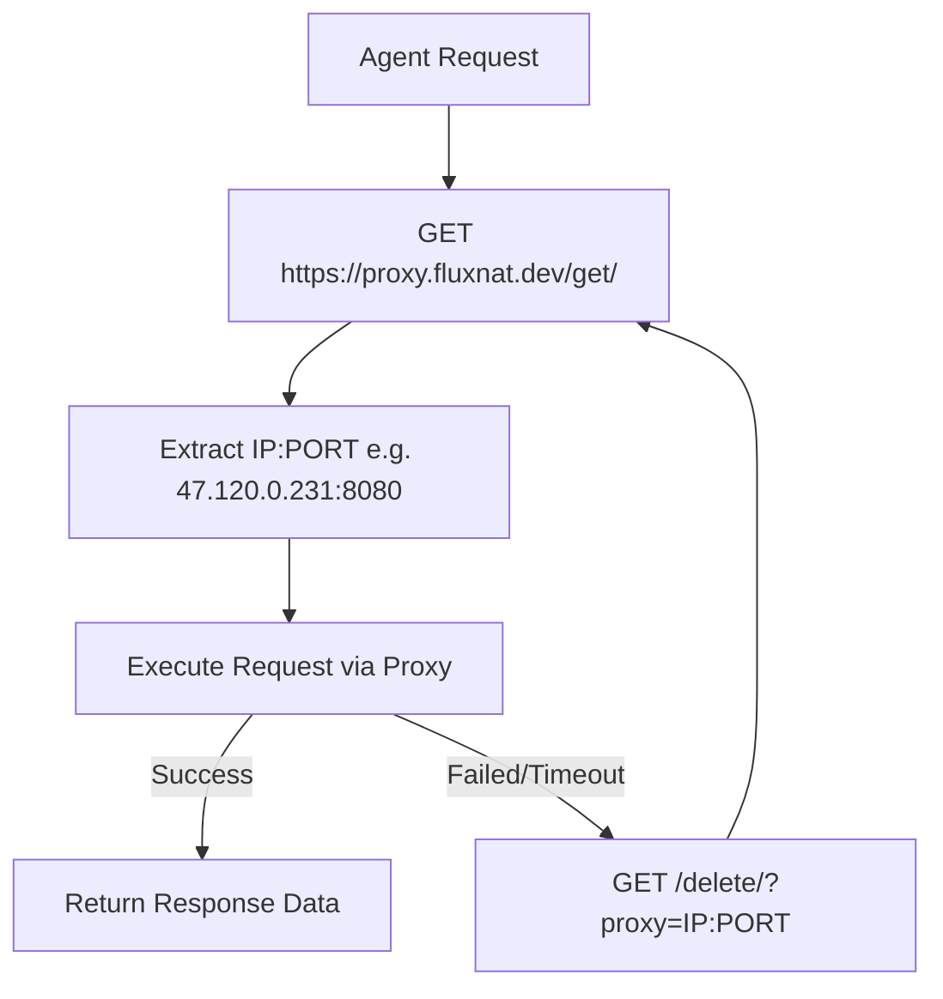

# FluxNat Rotating Proxy Pool Skill (`proxy`)

A comprehensive guide and reference skill for using the self-hosted **FluxNat Rotating Proxy Pool** (`https://proxy.fluxnat.dev`). 

Use this skill whenever an agent needs to route web requests through rotating IP addresses, bypass rate limits/blocks, or implement proxy rotation in scraping, automation, and API projects.

---

## 🔑 Endpoint Credentials & Specifications

| Property | Value |
| :--- | :--- |
| **API Domain** | `https://proxy.fluxnat.dev` |
| **Get Fresh Proxy Endpoint** | `https://proxy.fluxnat.dev/get/` |
| **Proxy Pool Stats Endpoint** | `https://proxy.fluxnat.dev/count/` |
| **All Active Proxies List** | `https://proxy.fluxnat.dev/all/` |
| **Delete Dead Proxy Endpoint** | `https://proxy.fluxnat.dev/delete/?proxy=IP:PORT` |
| **Authentication** | None required (Open HTTPS API) |
| **Protocol Support** | HTTP / HTTPS Forwarding |
| **Active Pool Size** | 100+ Live Verified IPs (Updated 24/7 in Redis) |

---

## ⚡ Core Proxy Workflow Protocol

When any AI agent needs to make proxied requests, follow this 3-step pattern:



1. **Fetch**: Query `https://proxy.fluxnat.dev/get/` to get a fresh pre-validated `proxy` string (`IP:PORT`).
2. **Execute**: Send the target HTTP request using `http://IP:PORT` as the proxy with a 5-10 second timeout.
3. **Handle & Retry**: If the proxy fails or times out, report/delete the dead proxy via `https://proxy.fluxnat.dev/delete/?proxy=IP:PORT` and fetch a new proxy.

---

## 💻 Language Integration Templates

### 1. Python (`requests` + Auto-Retry & Auto-Delete)

```python
import requests

PROXY_POOL_GET = "https://proxy.fluxnat.dev/get/"
PROXY_POOL_DEL = "https://proxy.fluxnat.dev/delete/?proxy="

def get_rotating_proxy():
    """Fetch a fresh pre-validated proxy IP string from FluxNat Pool."""
    response = requests.get(PROXY_POOL_GET, timeout=5).json()
    return response.get("proxy")

def delete_bad_proxy(proxy_ip):
    """Remove a dead proxy from Redis pool."""
    try:
        requests.get(f"{PROXY_POOL_DEL}{proxy_ip}", timeout=5)
    except Exception:
        pass

def fetch_with_proxy(url, max_retries=3):
    for attempt in range(max_retries):
        proxy_ip = get_rotating_proxy()
        if not proxy_ip:
            continue
            
        proxies = {
            "http": f"http://{proxy_ip}",
            "https": f"http://{proxy_ip}"
        }
        
        try:
            print(f"[Attempt {attempt+1}] Routing request via proxy: {proxy_ip}")
            response = requests.get(url, proxies=proxies, timeout=10)
            if response.status_code == 200:
                return response.text
        except Exception as e:
            print(f"Proxy {proxy_ip} failed ({e}). Deleting and retrying...")
            delete_bad_proxy(proxy_ip)
            
    raise Exception("Max retries exceeded with proxy pool")

# Example Usage
if __name__ == "__main__":
    html = fetch_with_proxy("https://httpbin.org/ip")
    print(html)
```

---

### 2. Node.js (`axios` + `https-proxy-agent`)

```javascript
const axios = require('axios');
const { HttpsProxyAgent } = require('https-proxy-agent');

const PROXY_GET = 'https://proxy.fluxnat.dev/get/';
const PROXY_DEL = 'https://proxy.fluxnat.dev/delete/?proxy=';

async function getProxy() {
    const res = await axios.get(PROXY_GET);
    return res.data.proxy;
}

async function deleteProxy(proxyIp) {
    try {
        await axios.get(`${PROXY_DEL}${proxyIp}`);
    } catch (e) {}
}

async function fetchWithProxy(url, retries = 3) {
    for (let i = 0; i < retries; i++) {
        const proxyIp = await getProxy();
        const agent = new HttpsProxyAgent(`http://${proxyIp}`);
        
        try {
            console.log(`[Attempt ${i + 1}] Using proxy ${proxyIp}`);
            const res = await axios.get(url, { httpsAgent: agent, timeout: 10000 });
            return res.data;
        } catch (err) {
            console.log(`Proxy ${proxyIp} failed. Purging and retrying...`);
            await deleteProxy(proxyIp);
        }
    }
    throw new Error('All proxy attempts failed');
}

// Example Usage
fetchWithProxy('https://httpbin.org/ip').then(console.log);
```

---

### 3. Puppeteer / Playwright (Browser Automation)

```javascript
const puppeteer = require('puppeteer');
const axios = require('axios');

async function launchBrowserWithRotatingProxy() {
    // 1. Get proxy IP
    const res = await axios.get('https://proxy.fluxnat.dev/get/');
    const proxyIp = res.data.proxy;

    console.log(`Launching Puppeteer with proxy: ${proxyIp}`);

    // 2. Pass proxy parameter to browser launch
    const browser = await puppeteer.launch({
        headless: "new",
        args: [`--proxy-server=http://${proxyIp}`]
    });

    const page = await browser.newPage();
    await page.goto('https://httpbin.org/ip', { waitUntil: 'networkidle2' });
    const content = await page.content();
    console.log(content);

    await browser.close();
}

launchBrowserWithRotatingProxy();
```

---

### 4. cURL / Shell One-Liner

```bash
# Fetch fresh proxy and make request in a single bash pipeline
PROXY_IP=$(curl -s https://proxy.fluxnat.dev/get/ | grep -oE '"proxy":"[^"]+"' | cut -d'"' -f4)
echo "Using Proxy: $PROXY_IP"
curl -s -x "http://$PROXY_IP" http://api.ipify.org
```

---

### 5. Go (`net/http`)

```go
package main

import (
	"encoding/json"
	"fmt"
	"io"
	"net/http"
	"net/url"
	"time"
)

type ProxyResp struct {
	Proxy string `json:"proxy"`
}

func getProxy() (string, error) {
	resp, err := http.Get("https://proxy.fluxnat.dev/get/")
	if err != nil {
		return "", err
	}
	defer resp.Body.Close()

	var p ProxyResp
	json.NewDecoder(resp.Body).Decode(&p)
	return p.Proxy, nil
}

func main() {
	proxyStr, err := getProxy()
	if err != nil {
		panic(err)
	}

	proxyURL, _ := url.Parse("http://" + proxyStr)
	transport := &http.Transport{Proxy: http.ProxyURL(proxyURL)}
	client := &http.Client{Transport: transport, Timeout: 10 * time.Second}

	resp, err := client.Get("http://api.ipify.org")
	if err != nil {
		fmt.Printf("Proxy %s failed: %v\n", proxyStr, err)
		return
	}
	defer resp.Body.Close()

	body, _ := io.ReadAll(resp.Body)
	fmt.Printf("Routed IP via %s: %s\n", proxyStr, string(body))
}
```

---

## 🛠️ Verification & Monitoring Commands

Agents can run these commands directly to check pool health before scraping:

* **Get Pool Count & Breakdown**:
  ```bash
  curl -s https://proxy.fluxnat.dev/count/
  ```
* **Fetch Single Proxy**:
  ```bash
  curl -s https://proxy.fluxnat.dev/get/
  ```
